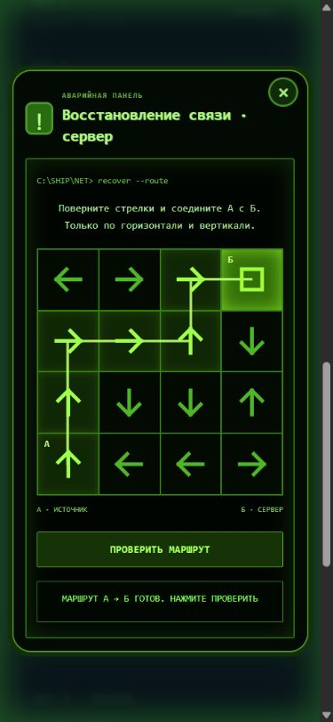

# Among Us Live

**A Telegram companion and mobile web app for playing a social deduction game in person.**

[Русская версия](README.ru.md)



Players join a room, receive private roles, scan physical QR task stations and complete
mini-games on their phones. A host manages the session while meetings, voting and sabotage
connect the digital game state to a live event.

## Features

- Telegram room creation/joining and a browser interface for players and hosts.
- Private roles, eliminations, ghosts, meetings, voting and victory conditions.
- QR task stations, mini-games and sabotage mechanics.
- Test players for rehearsing a session.
- SQLite persistence and an explicit local demo mode.
- A Python launcher that manages dependencies, the server and a Cloudflare tunnel for Telegram mode.

## Quick start

Requires **Python 3.11+**. First launch needs internet to install dependencies.

```sh
python run.py --demo
```

The launcher opens the local host interface. Demo mode does not require a Telegram token.
Keep the terminal open; stop the application with Ctrl+C.

### Telegram mode

1. Create your own Telegram bot with BotFather.
2. Copy `.env.example` to `.env` and set `BOT_TOKEN`, or use the launcher's private token prompt.
3. Run `python run.py` (Windows users can double-click `START.cmd`).
4. Wait for readiness, open the bot and send `/start`.

The launcher starts an HTTPS tunnel for phone access. Internet, Telegram and the tunnel
service must be reachable. Changing the bot token is supported through `python run.py --setup`.

## Development

```sh
python -m pip install -r requirements-test.txt
python -m pytest -q
```

For a prepared environment: `python run.py --demo --no-install`.
Other flags: `--port`, `--data`, `--no-browser` and explicit `--tunnel` for demo connectivity checks.

| File/directory | Responsibility |
| --- | --- |
| `engine.py`, `task_rules.py`, `sabotage.py` | Game state, tasks and sabotage |
| `server.py` | FastAPI API, sessions and static web app |
| `bot.py` | Telegram interaction |
| `launcher.py`, `run.py` | Setup and process lifecycle |
| `static/` | HTML, CSS and JavaScript client |
| `tests/` | Game rules, API, bot and launcher tests |

## Configuration and data

Local `.env`, `data/`, SQLite databases and `.tools/` are excluded from Git.
The launcher also stores runtime configuration, including the bot token, under `data/`.
Never upload that directory or share logs/configuration without checking their contents.
Use a separate bot and an isolated data directory when rehearsing a live session.

This is a prototype for hosted live sessions. Test the chosen venue, connectivity and
game flow before an event. No production hosting or uptime guarantee is implied.

## Attribution

This is an independent fan project inspired by **Among Us**. It is not affiliated with
or endorsed by Innersloth. Among Us and related marks belong to their respective owners.
No upstream game assets are bundled in this source package.

No open-source license has been selected for this project yet.
