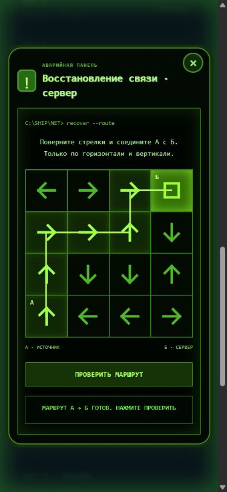

# Among Us Live

**Telegram-бот и мобильное веб-приложение для игры в Among Us вживую.**

[English](README.md)



Участники входят в комнату, получают личные роли и выполняют мини-игры на телефоне,
сканируя QR-коды станций. Ведущий управляет сессией; приложение поддерживает
убийства, призраков, совещания, голосования, саботажи и завершение игры.
Для репетиции предусмотрены тестовые игроки и локальный деморежим.

## Быстрый запуск

Нужен **Python 3.11+**. При первом запуске зависимости устанавливаются через интернет.

```sh
python run.py --demo
```

Для игры через Telegram создайте своего бота через BotFather, скопируйте
`.env.example` в `.env`, заполните `BOT_TOKEN` и выполните `python run.py`.
На Windows можно открыть `START.cmd`. Лаунчер также умеет запросить токен без отображения.
Дождитесь сообщения о готовности и отправьте боту `/start`.

Для доступа телефонов Telegram-режим поднимает HTTPS-туннель Cloudflare.
Окно запуска должно оставаться открытым; остановка — Ctrl+C.
Перенастройка токена: `python run.py --setup`.

## Технологии и проверки

Python, FastAPI, Uvicorn, SQLite, HTTPX, QR-коды; HTML/CSS/JavaScript на клиенте.

```sh
python -m pip install -r requirements-test.txt
python -m pytest -q
```

Тесты покрывают движок, API, бота, задачи, саботажи и запуск.
Структура модулей и дополнительные параметры описаны в [English README](README.md).

`.env`, `data/`, локальная база и `.tools/` в Git не включаются.
В `data/` сохраняется конфигурация с токеном: эту папку также нельзя публиковать.
Перед мероприятием проверьте сеть на площадке и проведите пробную игру.

Независимый фан-проект; не связан с Innersloth и не одобрен компанией.
Товарные знаки принадлежат их владельцам. Лицензия на открытое использование кода пока не выбрана.
